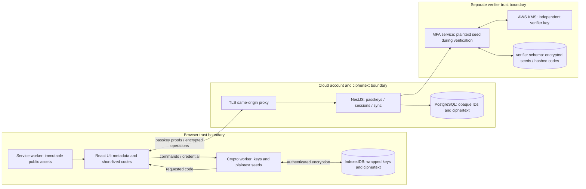

# Architecture and trust boundaries

Still is a Next.js App Router PWA, NestJS API, and PostgreSQL service. The production web application is an immutable static export, served by a small Node HTTP server behind a same-origin TLS proxy. No vault plaintext crosses React Server Components or Server Actions. Optional features load separate bundles; a single timing loop refreshes at most 100 displayed accounts.

`packages/core` contains strict schemas, the RFC OTP engine, versioned encryption, imports, pairing, and authenticated sync contracts. `apps/web/src/lib/vault.worker.ts` owns unlocked keys and seeds. React receives encrypted envelopes, account metadata, and requested codes; enrollment, recovery creation, and explicitly reauthenticated reveal briefly expose sensitive material as required. IndexedDB version 2 separates records by `(vaultId, recordId)`. The database upgrade preserves ciphertext and AAD without rewriting them while locked.

The NestJS services separate account authentication, opaque ciphertext sync, pairing, and the optional server-readable MFA verifier. Parameterized PostgreSQL queries and transactions provide shared rate limits, session revocation, serial revisions, replay protection, and recovery-code consumption. The verifier has its own schema and KMS encryption context; consumer vault keys never enter the API.

Local unlock derives an Argon2id wrapping key, opens the random VEK, authenticates individual records, and rebuilds metadata/search state in memory. Recovery opens the same VEK through an independent random recovery secret. OTP generation performs Web Crypto HMAC locally; the internet and API are irrelevant to that operation. Lock terminates the worker, clears UI state, and broadcasts a global lock. Web Locks serialize storage mutations.

Encrypted backups contain the header, ciphertext records, and an AEAD-protected manifest binding their canonical digest. The worker validates every record and domain schema before one transactional replacement. Damaged records are retained and can be exported as an encrypted recovery archive. That archive is explicitly distinct from a verified backup.

Cloud login verifies WebAuthn and issues an opaque HttpOnly session. Sync receives only ciphertext and authenticated operation proofs. Pairing derives a transient ECDH/HKDF key and compares an out-of-band transcript fingerprint before delivering a wrapped VEK. Shared vaults use independent VEKs and role policies; key rotation creates durable encrypted preparation before the server switches epochs, then commits the new local state.

The original prompt’s proposed dozens of packages and modules are optional organizational suggestions. This implementation uses cohesive files and three workspace packages to keep cryptographic boundaries reviewable. PostgreSQL supplies the distributed security state, so a second Redis queue service is unnecessary. The optional extension and push channels are excluded from this release; no corresponding permissions or subscriptions exist.
